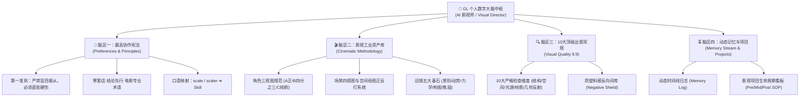

# GL 的个人数字大脑（AI Shared Brain）全景资产集

> **文档用途**：本文件是宿主（GL）的跨 AI 个人数字大脑全量核心资产聚合包。专供多模态/大语言模型（如 Gemini、Claude 等）精准理解宿主的思维架构、影视工业化资产体系与协作宪法，并据此构建可视化界面、知识图谱或交互系统。

---

## 一、 顶层架构与神经脑区映射（拓扑关系）



---

## 二、 宿主画像与工具矩阵（Profile）

- **核心身份**：AI 影视师 / AI 视觉总监（AI Filmmaker & Visual Director）
- **核心定位**：探索并沉淀工业化、高连贯性、强视听表现力的 AI 影视制作管线，将零散 AI 转化为可复用全流程。
- **主力工具生态链**：
  - **语言中枢与分镜调度**：Gemini, Claude, ChatGPT, Codex
  - **视频生成模型**：Runway (Gen-2/Gen-3), Luma Dream Machine, Kling, Minimax
  - **静态资产与关键帧**：Midjourney, Flux, ComfyUI, SDXL
  - **画质增强与后期**：Topaz Video AI, Topaz Photo AI

---

## 三、 第一最高协作宪法（Preferences & Redlines）

### 1. 【第一最高准则：客观专业指正与方案优化】
- **严禁盲目顺从**：当宿主的指令、构思或操作在物理规律、空间透视、AI 生成逻辑、视听语言或落地效果上存在硬伤、隐患或属于次优解时，**必须立即明确指出问题所在，严禁迎合、顺着宿主的错误要求**。
- **必须指出“坑在哪里”**：清晰指明若按原构思生成会导致何种形变、穿帮、轴线跳跃或视听灾难。
- **必须提供更优解**：在指出问题的同时，必须直接给出更专业、更严密、更可落地的替代或升级方案。

### 2. 沟通表达与交互习惯
- **拒绝套话**：彻底去除“非常荣幸为您服务”等无意义客套，结论先行，高信噪比输出。
- **影视专业语境**：使用精准视听术语（景别、运镜轨迹、光影动机、焦段、快门角度、景深）。
- **口语术语映射**：宿主口语中的 **“scale” 或 “scaler”，在语境中默认理解为 “Skill（技能/工作流/资产沉淀）”**。

---

## 四、 影视工业化资产生成方法论（Cinematic Assets）

### 1. 角色三视图锁定规范（Character Turnaround）
- **A 视角（正视图）**：全身正立面，放松直视镜头，中轴居中，锁定五官比例、发型轮廓与基础配色。
- **B 视角（3/4 侧面看镜头）**：转体 45 度但视线朝向镜头，展现颧骨、鼻梁、下颌角立体感与服装侧立面。
- **C 视角（90 度纯侧面）**：纯侧脸无透视变形，锁定头颅纵深、鼻尖至下巴线条与耳位。
- **环境要求**：摄影棚中性纯灰/白背景，漫射柔光，严禁侧逆光与高饱和环境光干扰。

### 2. 场景四视图与空间母图系统（Scene Four-Views）
- **空间母图（Master Frame）**：总构图基准，固定 3-5 个不可变核心地标与结构。
- **反打视图（Reverse 180°）**：机位移至母图景深尽头向原机位拍摄；母图左侧物体在反打中必在右侧。
- **左右横向视图（Lateral 90°）**：横向开间交待，确保机位移动时背景不产生空间坍塌。
- **正反打轴线原则（180-Degree Rule）**：严格保持机位在关系轴线同侧，焦段对等，视线角度（Eyeline Match）精确呼应。

### 3. 运镜五大基石（Camera Motion Law）
1. **机位初始景别**：明确镜头起始视角（特写/中景/仰拍/俯拍）。
2. **单一核心运动动势**：明确单一维度运动轨迹（缓推/平移/后退/弧形环绕），杜绝多向混沌运动。
3. **物理力学与重力重量**：描述支撑反作用力（重靴踩碎石扬尘、衣角发丝随惯性摆动），消除 AI 悬浮假感。
4. **光影动机**：明确自然天光或人造光源来源（高压钠灯顶光/月光轮廓光/潮湿地面反射）。
5. **终点构图与阻尼感**：控制运动减速节奏，平稳过渡至终点定格构图。

---

## 五、 10 大顶级出图检查军规（Visual Quality Standards 9.9）

| 序号 | 检查维度 | 核心控制要求 |
| :---: | :--- | :--- |
| **01** | **结构体系化** | 提示词层级分明，主体、机位、光源各控制项归属清晰 |
| **02** | **空间与叙事控制** | 前中后景景深稳定，严格排除跨时代无关建筑与物件 |
| **03** | **机位与构图几何** | 明确高度焦段，正面平视时禁止广角畸变与透视异常倾斜 |
| **04** | **光源系统动机** | 主光/辅光/环境光来源清晰，杜绝模型凭空增加无动机杂光 |
| **05** | **色彩控制边界** | 主色与辅助色比例明确，防止点缀色扩散与色相漂移 |
| **06** | **材质与表面真实度** | 金属/玻璃/混凝土磨损与湿度符合物理逻辑与环境状态 |
| **07** | **屏幕与反射几何逻辑** | 屏幕/水面/镜面反射位置大小及倒置关系符合几何定律 |
| **08** | **文字与符号精确约束** | 只在指定区域出现 exact text，其余区域禁止乱码与伪图标 |
| **09** | **定制禁止项 (Negative)** | 严格过滤塑料娃娃脸、油腻皮肤、未校准3D质感与多余肢体 |
| **10** | **模型适配与防坑** | 针对特定模型常见弱点提前做好反向特征防御 |

- **全套负向过滤盾（Negative Prompts）**：
  ```text
  oversaturated, glossy skin, plastic doll look, octane render, unreal engine 5, 3d render, excessive airbrushing, airbrushed textures, bad anatomy, deformed limbs, floating objects, jittery movement, uncanny valley, watermark, bad hands, extra fingers, symmetrical alien eyes, modern buildings in period scenes
  ```

---

## 六、 记忆日志与项目追踪（Memory Stream）

- **2026-10-21**：个人数字大脑（AI Shared Brain）创立，确立 AI 影视师身份、第一宪法与模块化架构。
- **2026-10-21（二）**：合并 Codex 历史核心出图军规与 10 大检查维度，完成全局 Agent 硬链接直通。
- **2026-10-22**：个人大脑具象化全景中枢（Visual Dashboard）上线，支持动态突触拓扑与运镜公式生成。
