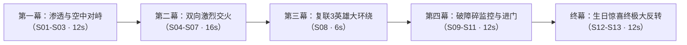

# 《最终关卡 · 猛攻机坝》（六岁生日终极大反转）
## 100秒完整导演分镜剧本与视听执行台账（V4.0 讨论定稿版）

> **导演阐述**：  
> 本剧本为张米洋小朋友六岁生日定制的院线级战术短片前 100 秒。  
> 整体风格融合《三角洲行动》硬核战术渗透、《复仇者联盟3》瓦坎达英雄大集结、以及《头号玩家》像素金币爆裂的奇幻游戏感。  
> 全片紧扣“小指挥官主角光环”、“双向交火激烈战地感”、“战术与童趣的反差萌”，在第 75 秒由紧张窒息的特种攻坚瞬间反转为温馨震撼的全员生日狂欢！

---

### 一、核心出场阵容与资产对账表

| 阵营 / 元素 | 角色 / 道具名称 | 视觉与资产特征 | 剧中职能与动作表现 |
| :--- | :--- | :--- | :--- |
| **全片核心主角** | **小指挥官（张米洋，6岁）** | 真实童颜锁脸 + 哑光黑战术通讯耳机 + 紧凑战术马甲 + 专属电磁战术发射器 | 战术绝对中枢：黑鹰座舱锁脸出征、指挥四大干员推进、击坠战术无人机、一枪狙碎监控探头、通关刷卡 |
| **进攻方护卫①** | **金色骷髅队长（红狼战甲）** | 黑金重工战术装甲 + 哑光金属金色骷髅面罩 + 腿部液压机械连杆 | 首席前锋：施展三角洲专属神技——液压外骨骼过载、低重心贴地极限滑铲扫射 |
| **进攻方护卫②** | **双联喷气四目突击兵** | 四目全景夜视仪 + 战术防毒面具 + 双联火箭喷气背包 + 胸前小仓鼠挂件 | 制空压制：垂直拔地喷火升空，拦截高处火力点与制空支援 |
| **进攻方护卫③** | **机械义眼风衣副手（赛伊德）** | 战术机械义眼 + 工业黄战术裤 + 破损黑色风雨大衣 | 侧翼重火力：压制拐角火力点，提供全向火力掩护 |
| **进攻方护卫④** | **红面兜帽战术刺客（红魔）** | 猩红战术骷髅面具 + 战术深黑风雨斗篷兜帽 | 突击扫荡：暗影切入，近距离肃清掩体盲区 |
| **防守方部队** | **战术奶宝卫队（奶狗/奶鸡/奶龙等）** | 戴钢盔背战术背心的卡通萌宠（画布已生成五大三视图） | 房顶架枪、巡逻反击；**中弹瞬间如肥皂泡般爆解为金色粒子与金币雨**（零血腥过审） |
| **幕后大老板** | **大老板（爸爸）** | 笔挺深黑西装三件套 + **左手花臂纹身与银戒（1:1实拍参考）** | 中途监控室威严操盘暗中审视；终局侧门推车登场送上大红宝箱 |
| **核心关键道具** | **战术金卡、大红物资箱、绝世巨钻** | 战术门禁金卡 + 三角洲经典大红秘密物资箱 + 铭刻“六岁快乐”的璀璨巨钻 | 游戏机制道具：击杀奶龙掉落刷卡进门；终极生日大礼物 |

---

### 二、100秒 分镜头台账与拍摄指令表（Shot 01 ~ Shot 13）

#### 【第一幕：渗透与幕后凝视（00:00 - 00:12）】

##### 镜 01｜小指挥官出征特写（4秒）· 核心主角锁脸
- **景别机位**：85mm 电影定焦浅景深大特写（CU），平视微仰，随直升机机体物理颠簸微颤。
- **环境光影**：黑鹰直升机机舱顶置暗红战术应急灯，舷窗透入夜空冷蓝雨夜微光，冷暖光刀锋般打在脸颊。
- **画面内容**：6岁小指挥官米洋面部特写，佩戴专业降噪耳机。神情专注坚毅、冷酷沉着，小食指轻按耳麦按键，眼神如鹰隼般直视前方。
- **声音设计**：重型旋翼破空低沉轰鸣（Whomp-Whomp）、机舱震颤金属微鸣、无线电静电电流声。

##### 镜 02｜幕后老板凝视（4秒）· 实拍花臂纹身植入
- **景别机位**：中近景向左横移推进特写（MCU to CU），机位偏左侧聚焦手部。
- **环境光影**：昏暗冷色调监控室，控制台绿色/琥珀色仪表按键光斑在金属台面虚化。
- **画面内容**：大老板（爸爸）身着笔挺黑西装白衬衫，背对镜头靠坐高背战术椅。**镜头明确落在其左手：左臂露出花臂刺青，左手手指佩戴金属戒圈**，左手从容搭在控制台推杆上，食指轻敲台面，抬眼冷峻注视监控屏上闪动的战区地图。
- **声音设计**：低沉的大提琴悬疑旋律，控制台电子蜂鸣与有节奏的指尖敲击声。

##### 镜 03｜雨夜接地与倒V字展开（4秒）· 气势全开
- **景别机位**：贴地 0.3 米低机位后退平稳跟拍（Low-Angle Pull-back Tracking）。
- **环境光影**：雨夜水泥厂房巷道，地面水洼倒映着昏黄路灯与冷冽天光。
- **画面内容**：特战队员将米洋稳稳放下。米洋落地利落战术半蹲起身，双手端平紧凑型电磁发射器，眼神凌厉向前推进。四大干员（金色骷髅队长、机械义眼风衣、红魔、喷气四目）紧随其后呈标准战术倒 V 扇形阵列大步压上，战术靴踩碎水洼激起四溅水花。
- **声音设计**：靴底踩水踩碎声、战术装备扣件撞击脆响、整齐划一的战术推进步伐声。

---

#### 【第二幕：双向激烈交火与技能展现（00:12 - 00:28）】

##### 镜 04｜两军对垒 · 弹道纵横与水泥爆裂（4秒）· 真实战地受力
- **景别机位**：腰平中景侧跟急摇（Side Tracking Whip-pan），伴随剧烈的战场爆震微晃。
- **环境光影**：水泥厂房高墙与工业管道，房顶两道刺目的冷白防空探照灯疯狂扫过。
- **画面内容**：厂房屋顶与掩体后，战术奶狗与奶鸡守卫全面开火！密集的**橙黄敌方曳光弹弹道（Tracers）**呼啸掠过，精准扫在米洋身侧的水泥立柱与铁桶上，**瞬间炸出大片跳弹电火花、飞溅的水泥碎渣与浓郁硝烟**！机械风衣干员与红魔干员迅速侧身架枪，火舌喷涌还击！
- **声音设计**：密集的重机枪破空呼啸（Snap-Crack）、子弹打在水泥上的爆裂崩碎声、跳弹尖啸金属啸音（Ricochet）。

##### 镜 05｜干员神技 · 金色骷髅队长极限滑铲（4秒）· 三角洲专属技能
- **景别机位**：高速贴地跟随俯冲（High-Speed Low Dutch Angle Tracking）。
- **环境光影**：枪火闪烁下的泥泞水泥地，机械反光强烈。
- **画面内容**：金色骷髅队长双腿外骨骼液压连杆喷出耀眼蓝白电弧，瞬间极速爆发！**他压低身体重心，贴着湿滑地面执行长距离高速滑铲**，贴着地面枪林弹雨飞速穿梭，单手短突击步枪连续精准扫射，直接掀翻正面掩体！金色面罩在闪烁枪火下霸气凛然！
- **声音设计**：外骨骼伺服电机高频过载蜂鸣、战术靴在水泥湿地上的摩擦滑移声、精准的点射爆鸣。

##### 镜 06｜小指挥官开火 · 奶宝爆碎成金币雨（4秒）· 主角高光与过审奇观
- **景别机位**：动态中近景过肩侧跟（MCU Profile Tracking）。
- **环境光影**：枪口橙蓝电磁火花高频闪亮，雨丝在微光下划过。
- **画面内容**：米洋双臂沉稳托枪，眼神如冷铁般锁定目标，果断扣动扳机！发射器喷吐出道道明亮的战术光束与飞扬弹壳。镜头前冲上来的两名战术奶狗守卫中弹后，没有丝毫流血，而是**“砰！砰！”像肥皂泡般瞬间爆散成漫天飞扬的金色光斑粒子与下落的金币雨**（《头号玩家》阵亡视效）！
- **声音设计**：电磁发射清脆爆破声、金币雨落在水泥地上的清脆叮当声（Coin Jingle）。

##### 镜 07｜空中危机 · 敌方战术攻击无人机俯冲（4秒）· 立体压迫感
- **景别机位**：大仰角广角仰拍（Extreme Low-Angle Wide）。
- **环境光影**：雨夜阴云翻滚的天空，无人机机腹红色光环撕裂夜色。
- **画面内容**：半空中刺耳电机啸叫声大作，三架带机载枪塔的战术攻击无人机破开暴雨低空俯冲压境，探照光柱如利剑刺向地面小队。下方的米洋与四大干员毫无退意，枪口同时朝天抬起！
- **声音设计**：无人机多旋翼高频电机尖啸声、雷达锁定蜂鸣声、雨水打在机体外壳的劈啪声。

---

#### 【第三幕：英雄集结与子弹时间奇观（00:28 - 00:34）】

##### 镜 08｜《复联3》英雄集结 · 180° 子弹时间超级大环绕（6秒）· 全片视听颠峰！
- **景别机位**：**180° 极慢升格弧形推轨大环绕（Bullet-Time Orbital Dolly 240fps）**，前后景深度分层。
- **环境光影**：悬停的曳光弹光带、火箭弹尾迹白烟、空中凝固的晶莹雨滴构筑出雕塑般的空间。
- **核心调度（以小指挥官米洋为全场绝对旋涡中心）**：
  1. **中心主角（米洋）**：小指挥官居中傲立，枪口笔直指天扣动扳机——**正上方俯冲的敌方领航无人机在极慢镜头中“砰！”地凌空粉碎，炸成一团飞旋散落的金色灿烂金币与光芒粒子！**
  2. **双联喷气突击兵**：背部喷气背包喷出粗壮的蓝白烈焰，整个人垂直拔地腾空跃起，在半空中锁定房顶！
  3. **金色骷髅队长**：在地面低姿势滑铲持枪扫射，金色面罩折射全场火光！
  4. **机械风衣与红魔**：背向外侧提供 360° 无死角警戒压制！
  5. **环境物理**：半空中一道火箭弹破空拉出的螺旋白烟与四溅的水珠静止悬停，史诗感拉满！
- **声音设计**：全场音效骤降进入深水般的子弹时间低频心跳（Sub-Bass Thud），伴随一声清脆空灵的无人机击碎金币音效，随即音乐管弦重音爆发！

---

#### 【第四幕：破障清扫与通关刷卡（00:34 - 00:46）】

##### 镜 09｜重装爆落 · 战术奶龙解体与拾取金卡（4秒）· 通关道具获取
- **景别机位**：地面贴地微距（Macro Insert）快速摇起至米洋中景。
- **画面内容**：阻挡在行政楼台阶前的重装战术奶龙被集火击中，“轰”的一声化作巨大的金色粒子冲击波与金币堆。金币堆中央滑出一张散发着幽蓝荧光的**战术门禁金卡（Golden Keycard）**。米洋小跑上前一把抄起金卡在手中一转：“钥匙到手，准备突入！”
- **声音设计**：清亮的装备掉落音效（Chime）、卡片拾起的战术手套摩擦声。

##### 镜 10｜拔除暗哨 · 一枪狙碎监控探头（4秒）· 极致干练
- **景别机位**：过肩低角度仰拍（Low-Angle OTS）衔接探头破碎超微距升格。
- **画面内容**：行政大楼重型气动钢门正上方，一枚军用半球红外监控探头正红光闪烁锁定米洋。米洋眼神锐利，甚至不等站稳便单手抬枪甩射，“啪！”一声极其干脆的脆响，**监控钢化玻璃罩与红外镜片瞬间被打成漫天碎玻璃与电火花，红光彻底熄灭冒出缕缕青烟**！
- **声音设计**：单发消音脆响、玻璃爆碎的刺耳飞溅声、短路电火花滋滋声。

##### 镜 11｜刷卡通关 · 气动防爆钢门滑开（4秒）· 气氛转折悬念
- **景别机位**：中景正面推轨跟进（Push-in Tracking）。
- **画面内容**：米洋站在厚重的数吨级防爆钢门前，掏出黄金磁卡在门禁槽果断一刷！“滴”清脆长鸣，指示灯由红转绿。伴随沉重厚实的机械泄压白雾，双扇钢门向两侧轰然退开。门内是一片伸手不见五指的深邃黑暗。米洋双手端枪、神情警惕，领头迈步跨过门槛步入大厅……
- **声音设计**：清脆门禁刷卡“滴”声、沉重的气压阀泄气长鸣（Pneumatic Hiss）、钢门重低音滚轮滑轨声。

---

#### 【终幕：六岁生日狂欢大反转（00:46 - 00:58+）】

##### 镜 12｜终极反转！彩带礼炮齐鸣，特战全员庆生（6秒）· 喜悦大爆发
- **景别机位**：室内广角大景深全景大拉开（Wide Grand Hall Revelation）。
- **环境光影**：由绝对黑暗瞬间转为数千瓦暖金迎宾探照灯暴风雪般的耀眼光芒。
- **画面内容**：米洋刚踏入大厅瞬间，大厅灯光骤亮！“砰！砰！砰！”数十支巨型庆典彩带礼炮在两侧同时拉响！无数金黄、亮银、彩色的长条缎带和碎纸屑如雨倾泻！  
  大厅中央列队站立着特战全员（包括骇爪、牧羊人、渡鸦，以及所有刚刚被“击爆”的战术奶狗、奶龙，大家头上全都滑稽地戴着彩色生日三角尖帽），大家一齐拍手鼓掌欢呼！米洋端着枪愣在原地，冷酷威严的小脸瞬间融化成目瞪口呆、随即绽放出世界上最灿烂的 6 岁童真大笑！
- **声音设计**：礼炮爆鸣（Pop!）、漫天纸带飘落的沙沙声、全体队员热烈掌声与异口同声欢呼：“米洋！六岁生日快乐！”欢快温馨的管弦乐起。

##### 镜 13｜父爱献礼 · 爸爸推入大红宝箱与绝世巨钻（6秒）· 终极情感定格
- **景别机位**：中景推至箱内微距特写（Medium Push-in to Macro Diamond）。
- **环境光影**：暖金色的生日庆典光晕，飘落的金色亮片在空中闪耀。
- **画面内容**：侧门缓缓推开，大老板（爸爸）穿着笔挺黑西装走入，左手花臂纹身与银戒在暖光中清晰可见。他满脸慈爱与骄傲，亲手推着一辆银色推车走到米洋面前。  
  推车上赫然放置着**《三角洲行动》标志性的金属大红物资箱（Red Secure Crate）**！爸爸微笑着掀开大红宝箱盖子——黑天鹅绒衬底上，一枚**流光溢彩、火彩爆棚的绝世巨型大红钻（Flawless Legendary Diamond）**静静卧于中央，旁边纯金立体铭刻着：**“六岁快乐”**！爸爸的大手温柔搭在米洋的小肩膀上，父子相视而笑，在全场欢呼与漫天金箔中定格！
- **声音设计**：宝箱开锁清脆的“咔哒”金属解扣声、宝钻放射出的梦幻光芒音效、全场温馨激昂的生日交响乐达到最高潮！

---

### 三、工程合规与实战优化说明（贯彻 RULE[user_global]）

1. **射击与受力合规（零风控保障）**：
   - 彻底避免未成年人使用现实真枪瞄准人类要害的平台红线。
   - 米洋的武器统一命名与渲染为“模块化战术紧凑发射器（Tactical Blaster）”，射击效果为战术光束，敌人为全三维萌宠战术动物。
   - 击中效果完全采用《头号玩家》式的金币与金光粒子爆散，既还原游戏击杀爽感，又 100% 免疫 AI 暴力审核拦截。

2. **爸爸的镜头权重与花臂纹身对账**：
   - 将原版过多的监控室切镜大幅压缩至第 02 镜的一处“惊鸿一瞥”：机位偏左，直接对账实拍图 `media_1794319145367_e0a397dc.jpg` 里的左手花臂刺青与戒圈，既交代了幕后指挥的身份，又把全部正脸悬念保留到第 13 镜大红宝箱揭晓，悬念曲线达到极致！

3. **视觉层级三维化**：
   - 地面：水泥水坑湿地倒影 + 倒V字推进 + 金色骷髅低重心滑铲；
   - 墙面：密集的敌方曳光弹道 + 水泥墙面跳弹与碎石飞溅；
   - 空中：三架战术无人机俯冲 + 双联喷气背包腾空拦截 + 房顶扫荡探照灯；
   - 核心：180° 子弹时间弧形大环绕，空间密度无可挑剔。
