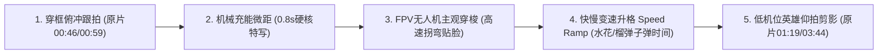

# 《最终关卡 V3 · 猛攻机坝高燃版》深度调研与分镜重构方案

> [!IMPORTANT]
> **核心诊断与升级方向**：原 v2 版分镜之所以显得“平”，是因为把《三角洲行动》拍成了“普通现代警匪端枪对射”——4 名队员面目模糊、毫无干员技能辨识度，关卡推进缺少游戏核心机制（无人机索敌、外骨骼突破、刷房卡、摸大红、拉闸绿烟）。本方案在 **100% 保留原有父子反转主线与时长框架（约 2 分 45 秒）** 的前提下，注入**纯正干员技能链 + 宣传片级高燃运镜 + 老玩家一秒沸腾的“机坝”社区热梗**。

---

## 一、 深度调研：《三角洲行动》高燃技能库与玩家必懂热梗盘点

### 1. 四大兵种招牌技能视觉化清单（彻底淘汰“4 个克隆杂兵”设定）

将米洋身边的 4 名精英队员直接升级为《三角洲行动》标准的 **G.T.I. 四大兵种满编顶配车队**，每名队员都有极强的视觉大招与分工：

| 队内编号 | 对应干员与兵种 | 标志性视觉外观 | 进分镜的王牌技能与高燃画面表现 |
| :--- | :--- | :--- | :--- |
| **1号尖刀** | **红狼（凯·席尔瓦）** 突击兵 | **蚀金玫瑰·黑金骷髅半面罩** + 腿臂液压机械外骨骼 | ① **【动力外骨骼】超载**：左腕摁下启动器，外骨骼蓝金电弧充能，暴雨中音障级狂飙突进； ② **【战术滑铲】**：贴着积水地面超长距离高速滑铲拉枪线，滑铲途中单手压枪横扫； ③ **【三联装手炮】**：左腕食指勾拉拉环，“嘭嘭嘭”连射三枚榴弹，利用墙面反弹炸碎重机枪掩体； ④ **【突破型烟雾弹】**：瞬爆快散烟，掩护小队长高速过点。 |
| **2号侦察** | **骇爪（或露娜）** 侦察兵 | 战术光学护目面罩 + 腕部全息终端 | ① **【信号破译器】**：启动扫描，潮湿地面与墙壁瞬间延伸出科幻感十足的**红/黄色敌方电子轨迹线**（透视墙后守军人数与位置）； ② **【闪光巡飞器】（追踪无人机）**：甩手放飞小型巡飞无人机，顺着黄色轨迹线自动高速拐弯追进走廊，贴脸爆闪致盲整排敌人！ |
| **3号工程** | **牧羊人** 工程兵 | 重型防爆领甲 + 背部无人机发射架 + 战术面罩 | ① **【声波无人机】（压制无人机）**：向大桥与变电站高空弹射放飞四旋翼声波无人机，悬停释放肉眼可见的**环形空气震荡波**，震得敌方机枪手捂耳减速、射速骤降； ② **【减振盾卫】**：爆炸冲击波袭来时挡在米洋身前硬吃气浪。 |
| **4号重火** | **威龙（或蜂医）** 突击 / 支援 | 战术重装面罩 + 喷气推进背包 + 腰挂**“鼠鼠挂件”** | ① **【喷气推进 + 磁吸炸弹】**：横向喷气瞬移躲火力，甩出磁吸炸弹贴爆敌方防爆盾； ② **【虎蹲炮】（明代火炮现代战术版）**：架起粗犷手持空气炮轰出一发巨型压缩气浪，零血腥直接把走廊守军全部震飞掀翻！（若配**蜂医**则额外带【激素枪】与绿色烟幕无人机）。 |

---

### 2. 老玩家一秒破防/沸腾的 7 大“零号大坝（机坝）”社区热梗

| 热梗 / 黑话 | 游戏内出处与玩家共鸣点 | 植入本片的绝妙设计（既热血又好笑） |
| :--- | :--- | :--- |
| **① “4 保 1 顶配护航小老板”** | 社区最火玩法：4 个满改六套大佬（护航队）把“老板”护在中间清图，让老板一个人舒舒服服吃肉开包。 | **全片底层关系核**：6 岁、身高 1.15m 的米洋就是全服排面最大的**“6 岁寿星小老板/总指挥”**！四个 1.85m 满配干员把他护在菱形正中，跪地听令、清场让路。 |
| **② “鼠鼠摸水泥搅拌车”** | 零号大坝水泥厂必打卡动作：无数“摸金鼠鼠”路过转动的混凝土搅拌车下料口必按 F 摸一下看有没有大红。 | **第一关 2 秒神来之笔**：水泥厂刚打完，4 号队员（背包挂着小蜜蜂鼠鼠玩偶）路过搅拌车手痒去摸，刚摸出个发光金块，米洋回头一记“严肃队长眼神杀”，队员秒怂立正归队！ |
| **③ “大电遭遇超雄老赛”** （翻滚 + 夺命火弩） | 主变电站俗称**“大电”**；大坝 BOSS **赛伊德（老赛）**以身法鬼畜的**战术翻滚**和一箭秒六套的**燃烧弩（火弩）**成为全服心理阴影。 | **第二关战力升级**：不再是无名机枪兵，而是由**红面具黑披风的“超雄老赛”亲自坐镇大电楼顶**！老赛一发【燃烧弩】在桥头炸起烈焰火墙，还秀出招牌翻滚，最终被米洋用“声波无人机 + 红狼外骨骼滑铲手炮”制裁！ |
| **④ “摸老赛出红卡 → 刷东楼经理室”** | 打死老赛最爽的瞬间就是摸出**东楼经理室钥匙卡（泛红光的顶级房卡）**，再去行政楼刷卡开大保险箱（破产/暴富圣地）。 | **完美打通二、三关剧情锁**：第二关击败老赛后，掉落一张泛着红光的**【核心监控室·专属红卡】**！第三关尽头米洋亲自踮起脚尖，拿红卡“滴——”一声刷开 BOSS 房防爆大门！ |
| **⑤ “开大保险爆【非洲之心】+ 双手检视动画”** | 《三角洲行动》最高荣耀：在经理室红色大保险箱/航空箱里开出顶级大红藏品**【非洲之心】**（璀璨巨钻），触发双手捧起转圈检视动画。 | **BOSS 房庆生高潮暴击**：开灯后爸爸推出来的**红色高级军用航空物资箱蛋糕**，顶盖掀开泛起游戏同款**“出大红金红光柱”**！蛋糕顶除了 `"6"` 字蜡烛，正中还立着一颗闪耀的糖艺巨钻**【非洲之心】**，米洋双手捧起吹蜡烛！ |
| **⑥ “猛攻得吃！”** | 2025–2026 最洗脑社区口头禅：“今天猛攻了吗？得吃了吗！”意为硬刚清图、满载而归。 | **反转字卡与台词彩蛋**：灯亮礼花炸响时，满墙监控屏跳出金色游戏横幅：**`【零号大坝已清图 · 寿星猛攻得吃！】`**。 |
| **⑦ “拉闸冒撤离绿烟 · 肥肥撤离”** | 撤离点拉闸后升起标志性的**浓郁绿色烟雾**，屏幕右上角出现绿色倒计时，全员蹲烟里欢呼“肥肥撤离”。 | **片尾骑马舞彩蛋封神**：行政楼前广场一拉闸，两侧喷出标志性**【撤离绿烟】**，右上角跳出 **`【撤离点开启 00:30 · 肥肥撤离】`**！爸爸戴墨镜带米洋、红狼，连复活的老赛都摘半边面具一起跳《江南 Style》！ |

---

## 二、 提炼自参考视频（`7b51b23f87eb06daa59e66a480b18cbf.mp4`）的五大高燃运镜密码

对照已逐帧读取的 [7b51b23f87eb06daa59e66a480b18cbf.mp4](file:///D:/work/导演生日/7b51b23f87eb06daa59e66a480b18cbf.mp4)，将平庸机位全面替换为以下 5 种宣传片级镜头语言：

1. **穿框俯冲与垂直桁架上帝视角（对标原片 `00:46` 水泥管口、`01:01` 钢桥桁架垂直俯拍）**：镜头穿过前景崩裂的钢筋混凝土框或大桥钢梁，从高处俯冲锁定下方菱形护卫队形。
2. **0.8–1.5 秒单兵装备微距启动（Gear Activation Macro）**：红狼按压腕部外骨骼启动器、食指勾拉三联手炮拉环、骇爪镜片投射红线、米洋小手刷红卡——极短促的硬核机械音画，瞬间拉爆高级感。
3. **FPV 无人机第一视角高速穿梭（Drone POV）**：牧羊人声波无人机飞越雨夜河谷、骇爪闪光巡飞器贴地蛇形冲入走廊拐角——第一人称带轻微电子扫描框的高速推镜，打破传统固定机位沉闷感。
4. **快慢交错变速（Speed Ramp）**：常速高速奔跑 → 滑铲起跳/手炮出膛瞬间骤降至 **0.2x 超慢镜**（看清雨滴悬停、外骨骼液压火花、老赛火弩擦肩而过）→ 落地爆破瞬间切回 **1.5x 极速冲击**！

> [!WARNING]
> **AI 视频生成防融化铁律（工程落地保障）**：华丽绝对不等于“把 5 个复杂动作塞进同一个 5 秒镜头”（那会导致 Seedance / Kling 出现多腿变形和枪械融化）。必须采用 **“单镜单奇观、快切拼连招”**——例如红狼破点拆成：`镜A（1.5s 腕部启动外骨骼微距）` → `镜B（2.5s 贴地积水滑铲射击慢镜）` → `镜C（2s 三联手炮榴弹反弹炸飞沙袋）`，每镜物理运动极其干净，剪辑合体燃度翻倍！

---

## 三、 《最终关卡 V3 · 猛攻机坝高燃版》全片分镜重构蓝图（供共创审阅）

> **主线承诺不变**：总长约 `2:45`｜米洋依然**全程只开走廊打爆摄像头那最帅的一枪**（其余火力全由四大干员释放，既符合6岁小统帅人设，又 100% 规避未成年持枪伤人审核风险）。

### 【序幕：猛攻机坝 · 护航车队集结】（`0:00 – 0:20`）
- **01｜黑屏加载与地图拍点（0:00–0:04）**：暴雨声与旋翼轰鸣。浮现《三角洲行动》烽火地带经典战术地图 UI，光标死死钉在零号大坝核心红区，弹出字卡：**`【绝密行动：零号大坝｜目标：攻入核心室，活捉最终 BOSS】`**。
- **02｜穿云航拍零号大坝（0:04–0:08）**：沿用已定稿母图 [SC01_零号大坝与水库_夜雨全景.jpg](file:///D:/work/导演生日/输出/02_场景概念图/SC01_零号大坝与水库_夜雨全景.jpg)，6500K 探照灯刺破雨幕，一架黑鹰直升机贴着狂暴水面压出环形水浪高速掠向水泥厂。
- **03｜黑鹰机舱“4 保 1 顶配护航局”（0:08–0:13）**：暗红舱灯下，左右坐着四名 1.85m 满配传奇干员（**黑金骷髅红狼、重甲牧羊人、光学面罩骇爪、背挂“小蜜蜂鼠鼠玩偶”的威龙**）。镜头下移——正中间坐着脚还不沾地、晃着小军靴的 6 岁小队长**米洋**（齐刘海、战术耳麦、橙色「米洋-1」臂章）。红狼转头看向他，米洋小手一挥握拳，四大干员齐刷刷低头拉栓上膛！
- **04｜BOSS 登场 · 西装暴徒（0:13–0:20）**：切监控室 [SC07A_监控室_BOSS冷蓝暗态.jpg](file:///D:/work/导演生日/输出/02_场景概念图/SC07A_监控室_BOSS冷蓝暗态.jpg)（桌角放着【典狱长白灰裁决面具】）。镜头绕过真皮椅背：爸爸一身黑西装、挽袖露出**哑光黑钛计时腕表**，戴着**钨钢尾戒**的手轻颠高尔夫铁杆，看着屏幕上的黑鹰嘴角一挑。定格字卡：**`【最终首领 · 西装暴徒】`**。

---

### 【第一关：水泥厂 · 突破烟 + 外骨骼首秀 + 搅拌车摸金梗】（`0:20 – 0:48`）
- **05｜关卡字卡 + 索降落地（0:20–0:25）**：字卡 **`【第一关 · 水泥厂】`**。四大干员滑降护住四周，红狼单手稳稳托着米洋落地；低机位仰拍米洋单膝触地、果断指向前方巷道。
- **06｜突破烟封视野 + 红狼外骨骼滑铲破点（0:25–0:34）**：
  - 巷道火力袭来，红狼甩出一颗**【突破型烟雾弹】**瞬封敌方视野；
  - **微距特写（1s）**：红狼左腕按下启动器，腿部**【动力外骨骼】**液压杆迸出蓝金电弧瞬间超载！
  - **高速跟拍切慢镜（3s）**：红狼化作黑金残影冲出烟幕，在积水沥青路上拉出五米水浪完成超帅**【战术滑铲】**，滑铲途中消音步枪精准点倒正面守军（护甲迸火花，无血迹）！
- **07｜小队菱形推进 + 水泥搅拌车“鼠鼠手痒”彩蛋（0:34–0:42）**：三大干员护着米洋穿过水泥厂，路过标志性**混凝土搅拌车**时，背挂鼠鼠玩偶的 4 号队员没忍住伸手往搅拌车口一摸——真摸出一块闪金光的小金条！米洋猛地回头瞪他一眼、小手指了指前方目标，4 号队员立马立正把金条塞回兜里跟上！
- **08｜监控室一阶段反应（0:42–0:48）**：爸爸靠在椅背悠闲颠着高尔夫球杆，看米洋管教手下忍不住轻笑一声。

---

### 【第二关：河谷大桥与“大电” · 声波无人机 vs 超雄老赛掉红卡】（`0:48 – 1:22`）
- **09｜超雄老赛登场：夺命【燃烧弩】封桥（0:48–0:55）**：字卡 **`【第二关 · 主变电站（大电）】`**。远景高地变电站楼顶，披黑袍、戴**猩红呼吸面具的【卫队长官·赛伊德（老赛）】**起身抬手就是一发玩家噩梦**【燃烧弩】**！火箭砸在西桥头防撞墩前轰然炸开熊熊烈焰火墙，小队被压在墩后。队员喊：“队长，是超雄老赛！过不去！”
- **10｜小统帅战术布置：海空立体协同（0:55–1:01）**：米洋探头看了一眼桥下湍急河床与高处老赛；四大硬汉齐刷刷**单膝跪地**与 1.15m 的米洋平视。米洋冷静比出两个战术手势：一指天空（放无人机），二指桥下河道（外骨骼绕后）！
- **11｜牧羊人放飞【声波无人机】FPV 俯冲震慑（1:01–1:07）**：2 号工程干员牧羊人单手向夜空弹射**【声波无人机】**！**切无人机 FPV 主观视角**高速掠过雨幕悬停在变电站头顶，“嗡——！”环形可视化声波轰然砸下，正在做招牌**“战术翻滚”**的老赛被震得动作僵直、捂住耳朵！
- **12｜河道跃出慢镜 + 红狼【三联装手炮】终结老赛（1:07–1:16）**：
  - **宣传片慢镜**：米洋带队踏碎河岸浅滩水花冲上东岸斜坡；
  - 红狼左腕食指勾动拉环，“嗵！嗵！嗵！”发射**【三联装手炮】**，三发榴弹借变电站水泥柱精准反弹炸翻沙袋掩体，老赛被气浪掀翻倒地，身上爆出一道耀眼的**红色光柱——掉落【核心监控室·红卡】**！米洋走上前帅气捡起红卡。
- **13｜监控室二阶段反应（1:16–1:22）**：大电屏幕信号中断。爸爸笑容消失，猛地坐直身体，左手紧了紧领带，右手按下对讲机：“连老赛都没挡住？行政楼——全员拦住他！”

---

### 【第三关：行政辖区 · 破译红线 + 闪光巡飞器 + 虎蹲炮 + 一枪爆监控】（`1:22 – 1:52`）
- **14｜骇爪【信号破译】+ 放飞【闪光巡飞器】+ 威龙【虎蹲炮】清场（1:22–1:33）**：
  - 字卡 **`【第三关 · 行政辖区】`**。走廊拐角，3 号侦察干员开启**【信号破译器】**，水磨石地面瞬间亮起三条刺目的**红黄敌方轨迹线**直通走廊掩体后；
  - 侦察干员顺手甩出**【闪光巡飞器】**，小无人机贴着走廊半空沿黄线急转弯冲进敌群爆开强白光（包括戴半脸面具的【渡鸦】守卫统统捂眼）；
  - 4 号重火干员威龙跨步上前，架起**【虎蹲炮】**轰出一发恐怖的环形压缩空气波，整条走廊的守军像保龄球一样被无伤震飞倒地！
- **15｜名场面：米洋发现监控，微笑一枪爆屏（1:33–1:43）**：硝烟散去，四大干员自动分列两侧让出中轴通道，米洋迈步走向走廊尽头。切**右上角监控探头鱼眼俯拍视角**：米洋停在探头正下方，第一次抬头直视爸爸的眼睛，嘴角扬起一抹自信微笑，缓缓抬起小冲锋枪——**“砰！”**（全片唯一一枪）火花炸裂，镜头碎成黑白雪花！
- **16｜爸爸反转伏笔 + 米洋刷“红卡”破门（1:43–1:52）**：
  - 监控室正中大屏炸成雪花光斑映在爸爸脸上，爸爸愣了一秒，突然欣慰地笑了，按下对讲机：**“各单位——按计划行动。”**
  - 走廊尽头厚重防爆钢门前，红狼半蹲下来托了一把米洋，米洋把刚爆出的**【红色钥匙卡】**往刷卡器上一贴——“滴！红灯转绿灯”，威龙一脚踹开大门！

---

### 【终局 BOSS 房：空椅静音反转 → 开灯爆大红“非洲之心”蛋糕】（`1:52 – 2:25`）
- **17｜空椅静音反转（1:52–2:00）**：昏暗监控室冷蓝屏光闪烁，米洋带四大干员战术逼近正中央背对门口的高背真皮椅。米洋用枪口轻轻一推椅背——椅子转过来，**空的**，只有那根镀铬高尔夫铁杆斜靠在扶手上。BGM 骤停，死一般寂静。米洋眨眨眼：“……人呢？”
- **18｜开灯复活 + 爆顶级大红【非洲之心·红色物资箱蛋糕】（2:00–2:18）**：
  - **“啪！”** 3200K 暖金阵列大灯瞬间全亮（无缝切换至 `SC07B` 亮灯态）！满墙大屏跳出游戏金色通报：**`【所有 NPC 已重生 · 寿星猛攻得吃！】`**；
  - 控制台后、门后，刚才被震倒的守军连同老赛一齐冒出来拉响礼花筒，漫天金片飞舞；
  - 右侧门打开，爸爸一身帅气西装推着餐车走出——车上正是泛着游戏**顶级大红金色光效**的**《三角洲》红色高级军用物资箱翻糖蛋糕**（插着 `"6"` 字蜡烛，箱顶还立着一颗璀璨的糖艺**【非洲之心】**大钻石）！
- **19｜检视大红与吹蜡烛（2:18–2:25）**：爸爸蹲下与米洋平视：“米洋，这一关你赢了。6 岁生日快乐！”米洋做出游戏经典的**双手捧起检视“非洲之心”惊喜表情**，一口吹灭蜡烛！画面定格结算：**`【BOSS 已击败｜全场最佳 MVP：张米洋（6岁）】`**。

---

### 【彩蛋：拉闸冒“撤离绿烟” · 全员《江南 Style》肥肥撤离】（`2:25 – 2:45`）
- **20｜拉闸绿烟 + 骑马舞肥肥撤离（2:25–2:45）**：
  - 行政楼前挂满暖金串灯的广场（`SC08`），米洋小手一拉电闸——广场两侧轰然升起《三角洲行动》玩家最爱的**【浓郁绿色撤离烟雾（撤离绿烟）】**，右上角弹出绿色 UI：**`【撤离点已开启 · 肥肥撤离倒计时】`**！
  - 《江南 Style》前奏炸响！爸爸戴上黑墨镜西装笔挺站正中，米洋站最前领舞；身后**金骷髅红狼、牧羊人、骇爪、威龙、甚至连红面具老赛**全员排成一排同步狂跳骑马舞（硬汉特战外骨骼跳骑马舞反差感拉爆）！
  - 最后一拍全员定格，米洋冲镜头比耶，弹出最终结算：**`【完美撤离 · 猛攻得吃｜本局收益：6 岁无敌快乐】`**！
