# 《最终关卡》（FINAL LEVEL · V3 导演定稿文学剧本）
### 《三角洲行动》零号大坝主题 · 张米洋 6 岁生日高燃短片（重构定稿版）

---

## 【剧本基本信息】

| 项目 | 核心参数与设定 |
| :--- | :--- |
| **片名** | 《最终关卡》（FINAL LEVEL） |
| **全片时长** | **02:45（165秒）**｜节奏：开场与BOSS亮相 20s ➔ 第一关水泥厂 28s ➔ 第二关大电大桥 34s ➔ 第三关行政楼 38s ➔ 终极反转庆生 25s ➔ 彩蛋骑马舞 20s |
| **影像规格** | 院线写实 CG / 电影级真人实拍质感｜画幅 **16:9（满画幅，无遮幅黑边）**｜对标《三角洲行动》官方电影级实机预告片 |
| **核心舞台** | 《三角洲行动》经典地图 · **「零号大坝」（Zero Dam）**（双曲拱坝、水泥厂四联筒仓、主变电站大桥、行政辖区战术走廊、北墙控制中心） |
| **领衔主角** | **张米洋（6岁）**：小队长【米洋-1】。齐刘海、圆脸、专注坚定、战术手势指挥、全片唯一开枪打爆摄像头。 |
| **最终首脑** | **爸爸 / 张导（30多岁）**：最终 BOSS【西装暴徒】。修身黑西装、白衬衫挽袖、黑钛计时码表、钨钢尾戒、手持镀铬高尔夫铁杆，坐镇冷蓝监控室。 |
| **护航天团** | **红狼（突击/外骨骼）**、**威龙（重装/摸金）**、**牧羊人（重盾/防暴）**、**骇爪（特勤/电子战）** |
| **阻截头目** | **卫队长官 · 赛伊德（超雄老赛）**（燃烧弩阻截）、**渡鸦**（机械义眼战术阻击） |

---

## 【第一最高准则与合规安全硬锁】

> [!IMPORTANT]
> **全片合规与安全物理硬锁（儿童安全与平台审核第一准则）：**
> 1. **寿星米洋绝对不向任何人物开枪**：米洋负责战术手势指挥（握拳停步、两指包抄、双指劈向河道、叉腰训斥），全片**唯一一枪**是 `场4` 举起儿童战术手枪果断打爆头顶的监控摄像头（破除 BOSS 视野）。
> 2. **交火全程零血迹、零伤残**：干员交火以护甲电火花、声波高频震荡、闪光致盲、虎蹲炮巨幅气浪无伤掀翻为主；守军倒地为战术失能判定。
> 3. **体型比例物理锚定**：米洋身高 `1.15m`，四大特勤干员身高 `1.85m`（`1:1.6` 绝对身高差）。干员听令一律单膝下跪（`1.20m`）平视；爸爸庆生时蹲下平视；米洋坐机舱时小军靴悬空不沾地。
> 4. **AI 生成纯净底片**：生成画面内部严禁自带任何英文字母、汉字、HUD 准星或血条，所有游戏关卡字卡、BOSS 名牌、倒计时与结算框全部由后期剪辑（AE/剪映）叠加。

---

## 【角色与资产绑定表】

| 角色编号 | 角色名称 | 视觉形象与定妆特征（绑定资产图） | 核心戏剧动作与道具 |
| :--- | :--- | :--- | :--- |
| **`@CHAR01`** | **张米洋（突击队长）** | 6岁突击队长。齐刘海、圆脸、ComTac战术耳麦；定制儿童黑色战术背心；左臂魔术贴贴着亮橙色臂章**「米洋-1」**；深灰战术裤配小军靴。 *(绑定：`6岁男孩战术形象设计.jpeg`)* | 手持带防丢绳的定制儿童手枪；全片核心手势指挥；捡起掉落的发光红卡；打爆摄像头；吹灭蜡烛。 |
| **`@CHAR02`** | **爸爸（最终 BOSS）** | 30多岁西装暴徒。利落背头、修身定制黑西装、白衬衫袖口挽至小臂；左手腕哑光黑钛计时码表，右手无名指与小指佩戴拉丝钨钢戒。 *(绑定：`zhangdao.png` / `张导01.png`)* | 手握镀铬高尔夫铁杆轻叩地面/颠球；靠坐高背黑真皮椅；按对讲机下令；推红色物资箱蛋糕车；墨镜骑马舞。 |
| **`@CHAR03_RW`**| **红狼（突击/战神）** | 蚀金玫瑰重装战术外骨骼。哑光黑碳纤维装甲嵌哑光香槟金包边，黑金骷髅半覆式面具。 *(绑定：`红狼01.png`)* | 单臂抱米洋滑降落地；腕部机械外骨骼启动（爆刺目蓝金电弧）；沥青路5米长战术滑铲横扫守军。 |
| **`@CHAR03_WL`**| **威龙（重装/摸金）** | 四目夜视仪（GPNVG-18）+ 战术防毒面具 + 橄榄绿防弹重甲；**战术背包挂着呆萌“小蜜蜂摸金鼠鼠”玩偶**。 *(绑定：`威龙.png`)* | 水泥搅拌车下料口手痒摸出金条；被米洋队长叉腰训斥后秒怂立正敬礼；肩抗虎蹲炮轰翻工事。 |
| **`@CHAR03_SH`**| **牧羊人（重装/防暴）**| 模块化全盔 + 防弹护颈高领 + 炭黑陶瓷重甲，手持声波震荡发射器。 *(绑定：`牧羊人.png`)* | 机舱左后坐镇；单膝跪地平视听令；背部单手弹射四旋翼【声波无人机】穿桥破障。 |
| **`@CHAR03_HC`**| **骇爪（特勤/电子战）**| 银灰短发波波头、全密封暗灰战术冲锋衣、黑白战术围巾、多功能侦察护目镜。 *(绑定：`骇爪.jpeg`)* | 投掷声波闪光无人机；甩出电磁飞镖瘫痪渡鸦义眼；掩护米洋突击。 |
| **`@CHAR05`**   | **赛伊德（超雄老赛）**| 阿萨拉卫队长官。猩红呼吸面罩、做旧黑斗篷兜帽、胸前挂满燃烧箭壶。 *(绑定：`卫队长官・赛伊德.jpeg`)* | 主变电站楼顶手持燃烧重弩射出火墙；被虎蹲炮掀翻单膝跪地；胸前爆出发光的【绝密红色门禁卡】。 |
| **`@CHAR06`**   | **渡鸦（阻截首脑）**  | 猩红发光机械义眼、做旧黑色立领风衣、亮黄紧身战术内衬。 *(绑定：`渡鸦.jpeg`)* | 行政辖区钢门前拔枪阻截；义眼被电磁飞镖命中短路冒烟退场。 |
| **`@CHAR04`**   | **NPC 防守队员**      | 战术头盔、护目镜、沙漠迷彩战术背心。 *(绑定：`NPC 防守队员.png`)* | 掩体阻截射击；中弹迸出护甲电火花倒地；反转后“重生”戴派对尖顶帽拉礼花。 |

---

## 【场景空间与灯光色彩母题】

```mermaid
flowchart LR
    SC01["SC01 零号大坝<br/>（航拍夜雨·冷青）"] --> SC02["SC02 黑鹰机舱<br/>（红光座舱·四干员护航）"]
    SC02 --> SC07A_1["SC07A 监控室暗态<br/>（8500K冷蓝·爸爸坏笑）"]
    SC07A_1 --> SC03["SC03 水泥厂<br/>（滑降·滑铲·搅拌车摸金）"]
    SC03 --> SC04_05["SC04_05 大桥与大电<br/>（燃烧弩·声波机·爆红卡）"]
    SC04_05 --> SC06["SC06 行政辖区长廊<br/>（走廊攻坚·一枪打爆摄像头）"]
    SC06 --> SC07A_2["SC07A 监控室雪花屏<br/>（空皮椅反转悬念）"]
    SC07A_2 --> SC07B["SC07B 监控室暖金态<br/>（3200K全亮·物资箱蛋糕庆生）"]
    SC07B --> SC08["SC08 广场彩蛋<br/>（撤离绿烟·墨镜骑马舞）"]
```

---

## 【剧本正文】

### 场 1｜序幕：猛攻机坝 · 4保1顶配护航车队集结
**内外景：外景 / 内景｜时段：夜（暴雨）｜地点：零号大坝上空 ➔ 黑鹰战术直升机舱内**  
**出场角色：`@CHAR01` 张米洋、`@CHAR03_RW` 红狼、`@CHAR03_WL` 威龙、`@CHAR03_SH` 牧羊人、`@CHAR03_HC` 骇爪**  
**绑定场景母图：`@SC01`（零号大坝航拍）、`@SC02`（黑鹰红光机舱）**

△ （黑屏）密集的暴雨抽打声，黑鹰直升机涡轮旋翼由远及近发出沉闷如雷的破空轰鸣。  
△ 【后期包装叠加】屏幕中央弹出冷绿雷达扫描线与战术文字：  
> **【行动代号：最终关卡 · 零号大坝】**  
> **【任务目标：突破三道防线，直取核心监控室，活捉最终首脑】**

△ （大远景航拍）暴雨如注的黑夜峡谷中，宏伟的混凝土双曲拱坝「零号大坝」横贯天地。两道炽白探照灯光束撕裂浓雾，扫过翻滚着黑浪的水库表面。  
△ 一架哑光黑涂装的黑鹰直升机贴着水面疾驰而入，强烈的旋翼下洗气流在深黑水面上压出一圈巨大的同心圆水雾浪花，呼啸着掠向大坝右侧工业区。

△ （硬切·机舱内全景）座舱内暗红顶灯呼吸般微弱闪烁。机舱中轴固定机位微晃。  
△ 机舱两侧长椅上，坐着四位身高 185cm、全副重甲武装的精英干员：  
- 左侧长椅：左前黑金骷髅【红狼】、左后防暴重盔【牧羊人】；  
- 右侧长椅：右前四目夜视仪【威龙】（胸挂带步枪，背后挂着呆萌的小蜜蜂摸金鼠鼠玩偶）、右后银灰短发面罩【骇爪】。  
△ 在四名魁梧如铁塔的巨汉正中央，坐着年仅 6 岁、身高仅 115cm 的突击队长——张米洋。  
△ 米洋穿着合身的儿童黑色战术背心，战术耳麦压在乌黑整齐的齐刘海上，左臂亮橙色臂章上赫然印着**「米洋-1」**。他两只穿小军靴的脚悬在长椅边，随直升机轻微晃动，形成视觉冲击极强的“巨汉众星捧月护萌宝”反差构图。

△ （平视微仰特写）米洋抬起头，那张肉嘟嘟的圆脸上没有一丝怯意，圆溜溜的眼睛里透着超出年龄的果敢与专注。  
△ 米洋右手干脆利落地握紧小拳头，在胸前有力地向下一挥！  
△ （中景）四周的红狼、威龙、牧羊人、骇爪见状，眼神瞬间肃杀，四柄重型突击步枪在红灯下同时横推、拉栓上膛！  
△ **【声音母题】** 四声极其清脆悦耳、严丝合缝的金属拉栓声——**“咔！嚓！”**。

---

### 场 2｜序幕转折：首脑现身 · 监控室内的从容注视
**内外景：内景｜时段：夜｜地点：大坝顶层核心控制中心（暗态监控室）**  
**出场角色：`@CHAR02` 爸爸（最终 BOSS【西装暴徒】）**  
**绑定场景母图：`@SC07A`（监控室暗态）**

△ （微距特写·贴地低角度）深灰色的防滑高光地面上，一只锃光瓦亮的镀铬高尔夫铁杆杆头，正一下一下有节奏地轻点着地面。  
△ **【声音母题】** 极其清脆、在死寂空间中回荡的金属撞击声——**“叮、叮、叮……”**。  
△ 镜头顺着金属球杆缓缓上摇：持杆右手的无名指戴着拉丝钨钢印章戒，小指扣着精致尾戒；左手腕露出哑光黑钛计时码表；白衬衫袖口整齐地挽到结实的小臂中间。

△ （半圆环绕中景）镜头从一张黑色高背真皮旋转椅的背后缓缓绕向正面。  
△ 30多岁的爸爸身着剪裁极其利落的深黑修身西装，姿态极其从容、慵懒地靠在皮椅内，右手修长的手指颠弄着高尔夫球杆。  
△ 满墙由数十块监控屏组成的巨型屏幕阵列散发着 8500K 冷蓝屏光，映亮了他刀削般的半边侧脸。正中央的主监控屏上，赫然显示着贴水面飞进来的黑鹰直升机机位！  
△ 爸爸看着屏幕，嘴角漫不经心地勾起一抹痞帅而自信的坏笑。  
△ 【后期包装叠加】画面定格 0.5 秒，弹出冷金边框的霸气名牌：  
> **【最终首领 · 西装暴徒】**  
> **【状态：观战中｜胜率预测：？？？】**

---

### 场 3｜第一关 · 水泥厂：外骨骼战术长滑铲与搅拌车摸金
**内外景：外景｜时段：夜（暴雨）｜地点：零号大坝水泥厂平顶 ➔ 工业巷道与四联筒仓**  
**出场角色：`@CHAR01` 米洋、`@CHAR03_RW` 红狼、`@CHAR03_WL` 威龙、`@CHAR03_SH` 牧羊人、`@CHAR03_HC` 骇爪、`@CHAR04` 阿萨拉守军 × 4**  
**绑定场景母图：`@SC03`（水泥厂工业巷道）**

△ 【后期包装叠加】画面左侧弹出工业风红黑关卡字卡：  
> **【第一关 · 突破外围水泥厂】**

△ （中远景俯拍）倾盆大雨抽打着水泥厂开阔平顶。黑鹰旋翼掀起狂暴的水雾，牧羊人、骇爪、威龙已索降落地，呈战术半圆举枪警戒。  
△ 最后一根降落绳上，身披黑金重甲的红狼单臂稳稳揽住米洋的胸腹，如天降神兵般从天而降，双脚踏上湿漉漉的屋顶，顺势将米洋轻轻放下。

△ （极低机位英雄仰拍）米洋小小的战术军靴“啪”地踏碎积水坑，单膝触地卸力后瞬间起身。  
△ 他眼神冷峻，毫不犹豫地伸出右手小食指，笔直指向前下方狭窄的工业运输巷道！  
△ 身后四名成年干员得到指令，如离弦之箭般越过米洋身侧，前插突进。

△ （全景手持微震）昏暗狭窄的水泥厂巷道内，远处废弃叉车与水泥台阶后，两名阿萨拉守军手持突击步枪疯狂扫射，橘黄色曳光弹撕裂夜雨。  
△ 红狼挺身跨步挡在米洋正前方，左手反手从胸前拔下一枚突破型白雾烟雾弹，猛力甩向巷道中段！  
△ “轰——！”浓郁的白色战术烟幕瞬间在狭窄巷道中爆开，彻底吞没守军视线。

△ （极特写微距）红狼左手闪电般按动右腕的【动力外骨骼控制钮】！  
△ 机械关节锁死，黑金液压杆疯狂伸缩，整套外骨骼关节处骤然爆发出噼里啪啦的刺目**蓝金充能电弧**！  
△ **【声音母题】** 游戏原汁原味的高频涡轮充能轰鸣——**“嗡——咔哒！”**。

△ （侧面低角度跟拍·含 0.2x 子弹时间慢镜）  
△ 红狼如同一头黑金猛兽悍然撞破白烟，双腿向前骤然铲出——  
△ 他贴着积满雨水的沥青路面，拉出一道长达五米、飞溅起半米高雪白水花的水幕长滑铲！  
△ 在高速滑铲的过程中，红狼单手持消音步枪果断平射，远处掩体后的两名守军胸甲瞬间迸发出两簇耀眼的金色防护火花，双双失控向后倒地！  
△ （常速恢复）红狼顺势单膝蹬地滑立起身，右手打出“安全，通过”手势。

△ （中景横移跟拍）小队护着米洋快步通过大型黄色水泥搅拌车旁。  
△ 负责殿后的 4 号干员威龙，看到搅拌车的下料斜斗时，职业病发作、手痒难耐——  
△ 他背上的“小蜜蜂摸金鼠鼠”玩偶随着跑动一颠一颤。威龙探头往搅拌车黑黝黝的料口一伸手，竟然“哧溜”摸出了一块金光灿灿的【高价值战术小金条】！  
△ **【声音母题】** 游戏摸金出金最悦耳的清脆提示音——**“叮——✨！”**。  
△ 威龙大喜过望，嘴巴在面罩下咧开，急急忙忙要把金条塞进胸前挂包。

△ （正反打仰拍·体型差爆笑戏剧点）  
△ 走在前方的米洋队长仿佛脑后长眼，猛地刹住脚步，转过身来。  
△ 米洋气鼓鼓地鼓起腮帮子，两只小手叉在小细腰上，圆圆的眼睛严厉地瞪向威龙，接着抬起左手，伸出小食指狠狠点了点自己的战术手表——意思是：“什么时候了还摸金？赶紧赶路！”  
△ 身高 185cm、身穿重装防弹甲的威龙当场浑身一激灵，吓得缩起脖子，火速把金条往兜里一揣，双脚并拢、“啪”地打了个笔挺滑稽的立正，向米洋恭恭敬敬敬了个军礼，乖乖小跑跟上。

---

### 场 4｜转折过场：监控室内的微妙变化
**内外景：内景｜时段：夜｜地点：大坝顶层核心控制中心（暗态监控室）**  
**出场角色：`@CHAR02` 爸爸**  
**绑定场景母图：`@SC07A`（监控室暗态）**

△ （中景缓推）监控室内，满墙屏幕冷蓝光依旧。  
△ 爸爸依然翘着二郎腿坐在皮椅上，但他原本随意颠球杆的右手已经停了下来，球杆立在两膝之间。  
△ 屏幕上正回放着米洋叉腰训斥大汉威龙的一幕。爸爸看着屏幕里那个个头虽小却威风凛凛的小家伙，眼神里掠过一丝极温柔的笑意，低声哼笑了一下。  
△ 但随即，他看到小队已经逼近第二关河谷大桥，神色渐渐收敛，嘴角浮起一抹考验对手的认真神采。

---

### 场 5｜第二关 · 河谷大桥：燃烧重弩封路与超雄老赛爆红卡
**内外景：外景｜时段：夜（暴雨）｜地点：河谷双层钢桁架大桥 ➔ 东岸高地主变电站（大电）**  
**出场角色：`@CHAR01` 米洋、`@CHAR03_RW` 红狼、`@CHAR03_WL` 威龙、`@CHAR03_SH` 牧羊人、`@CHAR03_HC` 骇爪、`@CHAR05` 赛伊德、`@CHAR04` 守军机枪手**  
**绑定场景母图：`@SC04_05`（河谷大桥与主变电站）**

△ 【后期包装叠加】画面左侧弹出工业风红黑关卡字卡：  
> **【第二关 · 强渡河谷大桥（主变电站）】**

△ （中近景仰拍）东岸变电站二层平台沙袋掩体后，披着做旧黑斗篷、戴着猩红呼吸面具的【卫队长官 · 赛伊德（超雄老赛）】猛地站直身躯！  
△ 他端起粗犷的改良型燃烧重弩，双目暴戾，对准西桥头狠狠扣动扳机！  
△ 一支粗壮的钢制重箭拖着刺目白热火尾尖啸射出，轰然钉在西桥头的混凝土防撞墩前！  
△ “轰隆——！！”三米高的炽烈火墙在暴雨中狂暴升腾，汽化周围雨水形成白灼热雾。  
△ 四大干员瞬间围成密不透风的人肉铁桶，将米洋死死护在防撞墩后方。

△ 牧羊人顶着防弹盾牌，扭头在嘈杂的枪火声中大喊：  
**牧羊人**  
（声嘶力竭）  
队长！是大电超雄老赛！燃烧弹封死了桥面，正门冲不过去！

△ （摇臂中景调度）米洋伏在防撞墩边缘，冷静地探出小脑袋。夜雨湿透了他的齐刘海，顺着小脸颊滑落。  
△ 他观察着地形：桥下是乱石嶙峋的枯水期河滩，正通向变电站侧面变压器群的死角。  
△ 米洋缩回脑袋转过身来。  
△ 就在米洋转头的瞬间，红狼、牧羊人、威龙、骇爪四位特勤巨汉**齐刷刷单膝跪地**！  
△ 四人的视线高度瞬间降到与米洋齐平的 1.2 米，全员肃穆等待队长的最终决断。  
△ 米洋没有半点犹豫，小手先是果断向夜空一指，随后并拢双指，像小战刀一样笔直向下斜劈向桥下浅滩！

△ （近景主观穿梭）牧羊人眼中精芒一闪，反手从背负装具上取下四旋翼【声波无人机】，单手向暴雨高空猛力弹射！  
△ 无人机喷射蓝光，以 FPV 穿梭机视角呼啸穿过复杂的钢桁架桥梁，直扑变电站二楼楼顶，在老赛头顶轰然释放高频透明声波震荡环！守军机枪手痛苦捂住耳罩。  
△ 紧接着，红狼与骇爪护送米洋挂扣滑降索，五人贴着桥墩凌空索降，如黑豹般踏上河床浅滩，涉水疾驰包抄。

△ （低角度中景）赛伊德刚甩头摆脱声波干扰，正前方的铁丝网突然被破障炸药撕开！  
△ 威龙大步踏出，肩上赫然抗着沉重的【虎蹲炮】，炮口正对沙袋掩体！  
**威龙**  
（闷声大吼）  
破障！

△ “咚——！！”虎蹲炮轰出肉眼可见的狂暴环形冲击气浪，直接将变电站门前的整排沙袋与工事横扫掀飞！  
△ 赛伊德被巨幅气浪迎面掀翻，在泥泞地面上倒滑三米，单膝跪地，手中的燃烧弩脱手砸出。  
△ 在老赛战术胸甲剧烈震荡的瞬间，“啪嗒”一声，一张泛着微弱呼吸红光的【绝密红色门禁卡】从他胸前弹匣包滑出，滴溜溜落在积水的鹅卵石缝隙间。  
△ 老赛单手按地，剧烈喘息，抬头看着冲过来的小队，眼中闪过惊异。

△ （近景俯推）米洋迈着小军靴快步小跑上前，蹲下身，伸出稚嫩但沾着泥水的小手，稳稳抓起那张发光的红卡。  
△ 米洋站直身躯，高高举起红卡，小脸上浮现出胜利的璀璨光芒！  
△ 四周干员齐声低喝喝彩。

---

### 场 6｜转折递进：首脑警觉 · 启动终极布防
**内外景：内景｜时段：夜｜地点：大坝顶层核心控制中心（暗态监控室）**  
**出场角色：`@CHAR02` 爸爸**  
**绑定场景母图：`@SC07A`（监控室暗态）**

△ （正面特写）监控室内。爸爸彻底收敛了笑容。  
△ 他身体前倾，紧紧抿着嘴唇，将手中的高尔夫球杆“笃”地一声重重顿在地面上。  
△ 大屏上，米洋正高举红卡带队冲入行政辖区主楼大门。  
△ 爸爸伸出左手，一把抓起桌上的黑色大功率对讲机，低沉而威严的声音传出：  
**爸爸**  
（语气沉稳有力，带着不加掩饰的压迫感）  
渡鸦，守住最后一道钢门。所有人——按第二预案，不准放他进来。

---

### 场 7｜第三关 · 行政辖区：走廊决战与打爆摄像头
**内外景：内景｜时段：夜｜地点：行政辖区核心战术走廊 ➔ 防爆主闸门前**  
**出场角色：`@CHAR01` 米洋、`@CHAR03_RW` 红狼、`@CHAR03_WL` 威龙、`@CHAR03_SH` 牧羊人、`@CHAR03_HC` 骇爪、`@CHAR06` 渡鸦、`@CHAR04` 守军 × 3**  
**绑定场景母图：`@SC06`（战术走廊与防爆门）**

△ 【后期包装叠加】画面左侧弹出工业风红黑关卡字卡：  
> **【第三关 · 行政辖区核心防线】**

△ （走廊纵深全景）阴冷的长廊两侧，红蓝双色战术警报频闪灯疯狂旋转，警报蜂鸣声震耳欲聋。  
△ 骇爪前滚翻突入，甩出两枚闪光蜂鸣无人机致盲走廊拐角的守军；红狼与牧羊人交替火力掩护推进，守军胸甲电火花四溅，接连退防失守。

△ （中近景）在走廊尽头的黑色重型防爆钢门前，黑风衣猎猎作响的【渡鸦】现身。他右眼的机械义眼闪烁着猩红光芒，正欲抬枪阻击。  
△ 骇爪在掩体后疾步侧身，手腕一抖，一枚闪烁着淡蓝电弧的特制【电磁飞镖】破空而出，“叮”地一声精准命中渡鸦的面部防具！  
△ 渡鸦的机械义眼瞬间被电弧短路、冒出一缕青烟，失衡后退，被迫退入右侧阴影安全门。

△ （中景推向特写）走廊里硝烟弥漫。干员们迅速在防爆钢门两侧贴墙戒备。  
△ 米洋小队长双手端着定制的小手枪，警惕地迈步走到走廊正中央。  
△ 忽然，米洋耳朵上的 ComTac 耳麦动了一下。他敏锐地察觉到了什么，猛地停下脚步，仰起小圆脸，直视正上方天花板角落。

△ （摄像头主观视角·全片视听高潮节点）  
△ 鱼眼广角监控镜头里，米洋正站在镜头正下方仰视。  
△ 米洋第一次正面捕捉到了这个一直窥探着全场的监控摄像头。  
△ 镜头里的小男孩没有恐惧，反而嘴角微微翘起，露出一抹极其聪慧、顽皮又霸气的微笑。  
△ 米洋双手沉稳举枪，黑洞洞的枪口径直对准了监控镜头的圆心！

△ （监控室内视点）爸爸正站在主屏幕前，死死盯着屏幕里儿子的笑脸。  
△ 爸爸瞳孔猛地一缩。

△ （极特写）米洋果断扣动扳机——  
△ “砰！！”清脆的枪声撕裂走廊，摄像机镜头应声炸裂成无数漫天飞射的玻璃碎片与火花！  
△ 画面在刺目的电火花中瞬间炸成**黑白雪花噪点**！

---

### 场 8｜终极反转：空转的皮椅与 3200K 暖金庆生狂欢
**内外景：内景｜时段：夜 ➔ 黎明｜地点：大坝核心控制中心（监控室暗态 ➔ 暖金庆生态）**  
**出场角色：`@CHAR01` 米洋、`@CHAR02` 爸爸、四大干员全员、赛伊德、渡鸦、全体 NPC 守军**  
**绑定场景母图：`@SC07A`（监控室暗态）➔ `@SC07B`（监控室暖金庆生态）**

△ （暗态监控室内）满墙屏幕中，正中央最大的主屏幕正“嗤嗤”闪烁着刺眼的黑白雪花噪点，映照在空旷的房间里。  
△ 爸爸被雪花光映得半明半暗，他站在屏幕前，愣了足足两秒钟。  
△ 旋即，爸爸紧绷的嘴角彻底融化，由错愕化为由衷的骄傲与宠溺大笑。他拿起对讲机，按下通话键：  
**爸爸**  
（轻声笑意，语气充满温暖与信号暗语）  
各单位注意——按原计划，行动！

△ （走廊门前）米洋从战术背心口袋里掏出那张发光的红色门禁卡，垫起脚尖，稳稳插进防爆钢门的电子插槽。  
△ 电子锁由红转绿，发出清脆的“滴——验证通过”提示音。  
△ 沉重无比的液压防爆门伴随着低沉的气压释放声，向左右两侧轰然滑开！

△ （慢镜头·低沉肃穆的 BOSS 战大提琴管弦）  
△ 白色破障烟雾从门底漫出。四大干员如临大敌，枪口对外成掩护阵型。米洋端枪走在最前，迈入昏暗的监控室。  
△ 房间正前方，黑色真皮高背椅正背对着大门。  
△ 米洋屏住呼吸，小心翼翼地走上前，伸出戴着战术手套的小手指，轻轻推了一下椅背。  
△ 真皮椅轴承缓缓旋转，向正面转了过来——  
△ **椅子上空空如也！** 根本没有人！  
△ 只有那一根镀铬的高尔夫铁杆，正安安静静地斜靠在真皮扶手旁。  
△ **【全片绝对静音断点】** 所有的 BOSS 战大提琴与环境背景音**瞬间完全切断！世界死寂 1.5 秒！**  
△ 米洋端着枪僵在原地，小圆脸上写满了错愕与茫然，呆呆眨巴着大眼睛。  
**米洋**  
（小声嘟囔，四处张望）  
……咦？人呢？

△ **“啪——！！”**  
△ 伴随一声清脆至极的电源总闸合闸巨响，全场天花板上成百上千盏 **3200K 暖金色阵列大灯在一瞬间全量爆亮**！整个房间被璀璨温暖的金光彻底吞没！  
△ 【后期包装叠加】正中主屏幕上的雪花瞬间消失，弹出大字：  
> **【所有 NPC 已重生！全员解除战斗状态！】**

△ “砰！砰！砰！砰！砰！”  
△ 控制台后方、隔断暗门两侧，原本中弹倒下的守军 NPC 们、渡鸦、赛伊德全都活蹦乱跳地窜了出来！  
△ 他们头上全都滑稽地歪戴着五颜六色的生日派对尖顶纸帽，手里端着巨大的礼花筒拼命拉响！无数金箔、彩带、心形亮片在暖金色的灯光里像暴风雨般漫天飞舞扬洒！  
△ 欢快的《生日快乐歌》管弦乐交响大合奏轰然炸响！

△ 右侧隐藏门伴随着轮子滚动的声响被轻轻推开。  
△ 爸爸一身笔挺黑西装，胸口插着一朵精致的红色小花，脸上挂着全天下最灿烂的笑容，推着一辆银色双层蛋糕车缓缓走了出来！  
△ 蛋糕车上摆着一只极其震撼的**三角洲【红色航空物资箱】造型生日翻糖蛋糕**，上面插着一根金灿灿的数字 **“6”** 蜡烛，旁边还用糖艺雕刻着璀璨夺目的【非洲之心】巨型钻石！  
△ 全体干员与全体 NPC 齐声拍手欢呼：  
**全体干员 & NPC**  
（齐声欢呼呐喊）  
米洋队长！6岁生日快乐！！

△ 爸爸把蛋糕车推到米洋跟前，双膝蹲下，让自己高大的身躯与 6 岁的儿子视线绝对平视。  
△ 爸爸伸出手，满眼宠溺地轻轻刮了一下米洋的小鼻尖。  
**爸爸**  
（眼中含着笑意与骄傲，声音温柔而厚重）  
张米洋队长，最后一关，你赢了。祝你 6 岁生日快乐！以后也要像今天一样，永远勇敢，永远向前冲！

△ 米洋终于反应过来，原本严肃紧绷的小脸瞬间绽开比太阳还要灿烂的笑容。他深吸一口气，用力吹灭了红箱蛋糕上的“6”字蜡烛！  
△ “呼——！”青烟袅袅升起，全场掌声雷动，红狼与威龙在旁边兴奋地击掌相庆。

△ 【后期包装叠加】画面定格，金光四射，弹出最终游戏结算名牌：  
> **【通关评价：SSS 级 · 完美通关】**  
> **【本场全场最佳 MVP：张米洋（6岁）】**

---

### 场 9｜尾声彩蛋：拉闸撤离与广场全员绿烟骑马舞
**内外景：内景 ➔ 外景｜时段：清晨（雨后晴光）｜地点：行政辖区走廊配电箱 ➔ 行政辖区前开阔广场**  
**出场角色：`@CHAR01` 米洋、`@CHAR02` 爸爸、四大干员全员、赛伊德、全体 NPC**  
**绑定场景母图：`@SC08`（行政辖区前广场）**

△ 【后期包装叠加】黑屏切入，屏幕中间跳出搞怪字体：  
> **【隐藏彩蛋 · 战术撤离协议】**

△ （监控室门外走廊）米洋小脸上还沾着一块蛋糕奶油，正好奇地打量着墙壁上一个漆成亮黄色的巨大工业手柄电闸。  
△ 电闸旁边印着一个大大的【撤离】标志。米洋伸出小手，使劲往下一扳——  
△ “咔哒！滋——！！”  
△ 墙壁排气阀里瞬间喷出一股浓郁得化不开的**亮绿色撤离信号烟雾**，迅速把整条走廊彻底淹没！

△ （硬切·外景全景大阳光）  
△ 雨过天晴的大坝行政楼前花岗岩大广场上，温暖的清晨阳光洒满大地。  
△ 广场左右两侧，两枚战术烟雾弹正源源不断地向天空升腾起标志性的**浓郁撤离绿烟**。  
△ 极其洗脑、极其魔性的《江南 Style》前奏电音伴随着重低音鼓点瞬间轰鸣炸响！  
△ （中景推向全景）广场正中央，一身笔挺黑西装的爸爸不知何时戴上了一副**纯黑反光黑超墨镜**，双手交叉在身前，表情严肃冷峻到极致（墨镜西装暴徒本色）。  
△ 米洋戴着小墨镜站在爸爸正前方。  
△ 身后一字排开：红狼、威龙、牧羊人、骇爪，以及摘下头盔的守军 NPC 和超雄老赛！

△ “Oppa Gangnam Style！！”  
△ 副歌响起的瞬间，全场画风彻底崩塌突变！  
△ 严肃帅气的爸爸带着儿子米洋，动作无比标准、律动感爆棚地大跳**骑马舞**！双腿飞快换步，双手像甩马缰绳一样拼命甩动！  
△ 身后 185cm 的黑金战神红狼动作极其僵硬但极其卖力；摸金威龙跳得前仰后合把肚皮都甩了起来；超雄老赛手舞足蹈直接笑场，全员在绿色撤离烟雾中疯狂群魔乱舞！

△ （全员定格终极镜头）  
△ 最后一个重音鼓点落下，全员突然原地摆出战术骑马定格姿势！  
△ 爸爸单膝跪地揽住米洋，单手扶着墨镜耍帅；米洋站在正中，冲着镜头开心地比起两只小手的“剪刀手耶”！四大干员与守军在背景漫天绿烟中齐刷刷竖起大拇指！  
△ 画面定格为一张高饱和度、高清晰度的家庭生日纪实大合影。  
△ 渐暗出字：  
> **张米洋小朋友 · 6 岁生日快乐！**  
> **愿你的生活永远充满爱与冒险，每一关都是最高评价！**  
> **— 2026.11 · 爸爸妈妈与全体制作组敬上 —**

**— 全剧终 —**

---

## 【全片台词与有声节拍总表】

| 镜头时序 | 角色 | 台词（中文字幕） | 情绪与语气指导 | 空间与调度说明 |
| :--- | :--- | :--- | :--- | :--- |
| **00:11** | 四大干员 | *(拉栓动作声)* **“咔！嚓！”** | 严整肃杀，金属质感 | 机舱座舱，整齐划一横推上膛 |
| **00:52** | 牧羊人 | **“队长！是大电超雄老赛！燃烧弹封死了桥面，正门冲不过去！”** | 声嘶力竭，被枪炮压制 | 贴桥头防撞墩后，护盾死死挡住火星 |
| **01:18** | 威龙 | **“破障！！”** | 闷声大吼，粗犷有力 | 肩抗虎蹲炮踏步轰击 |
| **01:28** | 爸爸 | **“渡鸦，守住最后一道钢门。所有人——按第二预案，不准放他进来。”** | 威严沉稳，压迫感十足 | 监控室内手持对讲机，身体前倾注视大屏 |
| **01:42** | 米洋 | *(枪响摄像头爆裂)* **“砰！！”** | 果断干脆，帅气霸气 | 走廊中轴仰拍，全片唯一一次开枪 |
| **01:48** | 爸爸 | **“各单位注意——按原计划，行动！”** | 宠溺轻笑，温暖号令 | 雪花屏映照下按对讲机暗语下达庆生指令 |
| **02:00** | 米洋 | **“……咦？人呢？”** | 呆萌困惑，小声嘟囔 | 旋转皮椅转过来后，面对空扶手发愣眨眼 |
| **02:06** | 全员 | **“米洋队长！6岁生日快乐！！”** | 齐声爆笑，欢声雷动 | 全场暖灯全亮，各角落拉礼花跳出 |
| **02:18** | 爸爸 | **“张米洋队长，最后一关，你赢了。祝你 6 岁生日快乐！以后也要像今天一样，永远勇敢，永远向前冲！”** | 极尽温柔，深情厚重 | 单膝跪地平视，刮儿子小鼻尖 |

---

## 【声音工程与配乐母题设计】

1. **序幕 ➔ 闯关推进（00:00–01:30）**：
   - 《三角洲行动》经典工业电子战鼓 BGM 渐入，鼓点节奏与心跳同步；
   - 随三关推进（水泥厂 ➔ 大桥 ➔ 行政楼），低频合成器贝斯逐级加重，间杂真实的暴雨雷鸣、破障气浪与护甲火花音效。
2. **决战前夕压迫感（01:30–01:58）**：
   - 米洋打爆摄像头后，BGM 突变为低沉、压抑、具有强烈危机感的 BOSS 战大提琴独奏，制造“即将面对终极西装暴徒”的假象悬念。
3. **全片核心戏剧转折点（01:58–02:01）**：
   - 空椅子转过来的刹那，**所有配乐、环境风声、电子底噪瞬间彻底静音 1.5 秒！** 实现电影级的“绝对真空断点”。
4. **庆生高潮大逆转（02:01–02:30）**：
   - 伴随“啪！”总闸合闸声与礼花“砰！砰！”齐鸣，音乐瞬间炸开为华丽辉煌的**管弦交响乐版《祝你生日快乐》**，情绪瞬间从紧张反转为巨大的温暖与感动。
5. **彩蛋洗脑反差（02:30–02:45）**：
   - 伴随绿色撤离烟雾喷发，硬切《江南 Style》高燃副歌电音，实现特勤硬汉大跳骑马舞的极致爆笑狂欢！

---

## 【后期剪辑包装资产清单（供剪映/AE直接套用）】

- [ ] **UI-01 行动简报字卡**：`【行动代号：最终关卡 · 零号大坝】`（冷绿雷达HUD风格）
- [ ] **UI-02 BOSS名牌**：`【最终首领 · 西装暴徒】`（暗金高光铭牌）
- [ ] **UI-03 关卡红黑字卡 × 3**：
  - `【第一关 · 突破外围水泥厂】`
  - `【第二关 · 强渡河谷大桥（主变电站）】`
  - `【第三关 · 行政辖区核心防线】`
- [ ] **UI-04 特殊事件提示**：`【所有 NPC 已重生！全员解除战斗状态！】`（绿字全屏通知）
- [ ] **UI-05 最终结算面板**：`【通关评价：SSS 级 · 完美通关】` + `【全场 MVP：张米洋（6岁）】`
